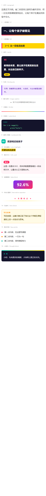

# 智汇排版 · 公众号工具

一个仿「壹伴」的微信公众号排版 Chrome 扩展。在 `mp.weixin.qq.com` 的图文编辑器右侧注入一个悬浮工具条，一键套用公众号能正常渲染的**内联样式**，并且可以把文章一键采集到 GitHub 存档。



## 为什么自己做

公众号编辑器只认内联 style，而且会清洗掉大量 CSS（`<pre>`、`box-shadow`、伪元素、外部样式表基本都活不下来）。网上的排版工具要么收费、要么导出的样式到了手机上就崩。

这个扩展的做法是：**所有排版都在本地拼成内联 style 的 `<section>`，直接插进编辑器，不经过任何第三方服务。**

## 功能

### 16 个排版预设

| 按钮 | 效果 |
| --- | --- |
| 正文 | 15.5px / 行距 1.9 / 两端对齐，干净无框 |
| 一级标题 | 深海军蓝色块 + 白字 + 底部三色渐变条，海报感 |
| 二级标题 | 明黄底 + 黑色粗体 + 玫红左边框，撞色 |
| 金句 | 深色卡片 + 大号引号 + 黄色「金句」胶囊标签 |
| 引用 | 淡紫底 + 紫色左边条 |
| 图片说明 | 居中灰字，前置 ▲ |
| 分割线 | 五色彩虹渐变条 |
| 代码块 | 深底 + 薄荷绿字，逐行输出，不会被吞换行 |
| 编号小标题 | 青绿圆角徽章「01」+ 粗体标题 |
| 荧光高亮 | 明黄底粗体，套在选中的词上 |
| 要点卡片 | 浅粉底 + 玫红「要点」胶囊 |
| 数据强调 | 紫→玫红渐变胶囊 + 30px 白字，放百分比很好看 |
| 彩色分隔符 | 「✦ 本 期 看 点 ✦」+ 渐隐线 |
| 引言块 | 米黄底 + 橙色虚线边 + 「写在前面」 |
| 要点列表 | 红 / 橙 / 青三色圆点，一次插入三条 |
| 小结块 | 深底 + 青黄渐变顶条 + 「小 结」 |

配色固定为一套高饱和撞色：深底 `#14142B`、玫红 `#FF2E63`、亮橙 `#FF8A00`、明黄 `#FFD400`、青绿 `#00C2A8`、紫 `#7B2FF7`。

### 其他按钮

- **一键全文排版** — 统一正文的字号、行距、字色，但会跳过已经套过样式的块，不会覆盖标题和代码块
- **清除选中格式** — 去掉 style / class，**保留文字**（不是删除）
- **复制富文本** — 同时写入 `text/html` 和 `text/plain`，粘到别处也是带格式的
- **采集到 GitHub** — 把当前编辑器里的内容转成 markdown + HTML，提交到指定仓库（默认 `Finnlove/wechat-articles`）

## 安装

1. 打开 `chrome://extensions`
2. 右上角开启「开发者模式」
3. 点「加载已解压的扩展程序」，选择本目录下的 `extension/` 文件夹
4. 打开任意一篇公众号图文编辑页，右侧会出现工具条；点标题栏的「—」可以收起

Chrome 157 之后已不支持命令行 `--load-extension`，只能手动加载。

## 微信排版的技术约束（踩过的坑）

这些是写这个扩展时踩出来的，改预设时务必遵守：

| 约束 | 说明 |
| --- | --- |
| 只用内联 style | 公众号会丢掉 `<style>` 和 class，样式必须写在元素上 |
| 根元素用 `<section>` | `div` 也能用，但 `section` 在微信编辑器里更稳 |
| 禁用 `<pre>` | 微信编辑器会把 `<pre>` 转成 `<p>`，换行符直接消失。代码块必须逐行 `<p style="margin:0;white-space:pre-wrap">` |
| 缩进用 `&nbsp;` | 每 2 个空格换 4 个 `&nbsp;`，否则缩进被吃掉 |
| 不用 `box-shadow` / 伪元素 / `position` | 基本都会被清洗，或者导出后错位 |
| 渐变要带底色兜底 | 写 `background:#FF6B35;background:linear-gradient(...)`，老客户端不认渐变时还有纯色 |
| 图片不能用外链 | 必须走微信自己的 `mmbiz.qpic.cn`，外链图在正文里会裂 |
| 宽度按 375px 设计 | 手机端内容区大约 375px，超过会溢出被裁 |

## 文件结构

```
wechat-typeset/
├─ extension/
│  ├─ manifest.json     MV3 配置
│  ├─ presets.js        16 个排版预设（改样式只需要动这个文件）
│  ├─ content.js        注入编辑器、面板 UI、套用/清除/复制/采集逻辑
│  ├─ background.js     action 点击 → 切换面板
│  ├─ panel.css         面板兜底样式
│  └─ README.md         扩展内说明
├─ preview.html         本地预览页：遍历 presets.js 渲染全部预设
└─ preview.png          预览长图（375px 手机宽度）
```

## 改样式

只改 `extension/presets.js` 就行。每个预设长这样：

```js
{
  id: 'h1',
  label: '一级标题',
  type: 'wrap',        // wrap = 套在选中文字上；insert = 直接插入新块
  build(text) {
    return `<section style="...">${esc(text)}</section>`;
  }
}
```

改完刷新 `preview.html` 就能看到效果，不用装扩展。

## 已知问题

- `wrap` 类型的预设（代码块、荧光高亮等）**必须先选中文字**再点按钮，没选中时点了没反应
- 采集功能依赖本地服务 `127.0.0.1:7357`（`flowus-github-sync/sync.js --serve`），服务没起会提示连不上
- 微信后台改版可能影响编辑器选择器，`content.js` 里的 `EDITOR_SELECTORS` 需要跟着更新

## License

MIT
